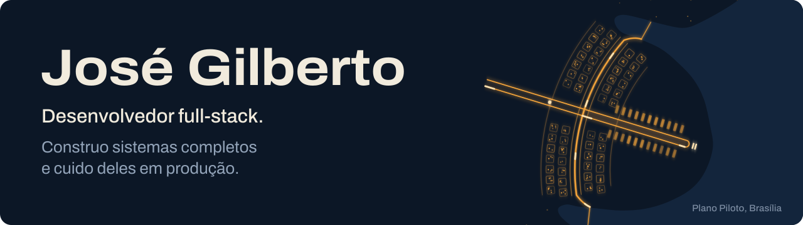

[English](https://github.com/Sitr3n01) · **Português**

Brasília, DF · [zegilfarias@outlook.com](mailto:zegilfarias@outlook.com) · Discord `sitr3n`

Desenvolvo e mantenho software de ponta a ponta, da modelagem de dados e interface aos testes, deploy e operação. Para um cliente real, cuido de uma plataforma Django + Wagtail que atende dois sites em produção e o painel editorial da equipe. Separadamente, construí um servidor pessoal de inferência em Go para agentes de código locais; ele funciona para o uso a que se destina e segue identificado como canary, sem qualificação formal de produção. Também desenvolvo sistemas de multiplayer e gameplay em projetos de equipe Unity no programa de incubação Brasília Game Hub.

## Projetos em destaque

  
  

### [news_portal](https://github.com/Sitr3n01/news_portal/blob/master/README.pt-BR.md) &nbsp; 

Um único código Django 5.2 + Wagtail 7.4 por trás de dois sites em produção para um cliente real e do painel editorial que a equipe usa todo dia. A [Komuniki](https://komuniki.com.br) é o site de uma escola de comunicação e artes, e o [Blog da Kelly](https://kellyfarias.com.br/news/) é um portal de notícias. Construí e opero tudo de ponta a ponta; está no ar desde junho de 2026.

**Em números:** 823 testes, cobertura de branches exigida a partir de 82%, 7 problemas de uma revisão interna de segurança (3 altos) corrigidos com teste de regressão, cache de build do Docker de 23,95 GB para 442 MB.

O que tem dentro

 

- **Movimento que respeita quem lê.** Hero em WebGL com three.js e shaders próprios, e reveal de texto com GSAP. Tudo isso recua com `prefers-reduced-motion`.
- **Um painel que a equipe da cliente usa de verdade.** O Django admin (Unfold) e o admin do Wagtail viraram um painel só, com fluxo editorial: o repórter escreve, o editor aprova, e o agendamento só publica revisão aprovada.
- **Revisão interna de segurança.** Uma revisão interna em cinco categorias de segurança achou 7 problemas (3 altos), todos corrigidos com teste de regressão. CSP com nonce, checagem de extensão e MIME nos uploads, login com Google, django-axes e Cloudflare Turnstile.
- **Operação numa VPS pequena.** Docker Compose atrás do Cloudflare numa VPS de 1 vCPU e 4 GB. O deploy é puxado pela VPS a partir de uma tag aprovada, então o CI não guarda credencial do servidor. Achei e corrigi um deploy que ficou dois meses repetindo em loop e imagens Docker que cresciam de forma quadrática com os dumps do banco, o que levou o cache de build de 23,95 GB para 442 MB.
- **Travas de qualidade.** 823 testes, cobertura de branches exigida a partir de 82% (hoje, 83,5%), CodeQL, pip-audit, varredura de segredos e `master` protegido.

**Tecnologias:** Python · Django · Wagtail · PostgreSQL · HTMX · Alpine.js · Tailwind CSS · three.js · GSAP · Docker · Nginx · GitHub Actions

### [Local AI Provider](https://github.com/Sitr3n01/local-ai-provider/blob/main/README.pt-BR.md) &nbsp; 

Servidor de inferência em Go, compatível com a API da OpenAI e restrito a loopback, que permite rodar agentes de código como Codex, Claude Code e OpenCode contra um modelo local, sem que código-fonte, prompts ou credenciais saiam da máquina.

**Em números:** overhead p95 de 18,2 ms no edge contra um gate de 50 ms, retenção de 120/120 até 240k tokens, 728 testes e subtestes Go, threat model e 22 ADRs.

O que tem dentro

 

É um plano de inferência e controle de admissão na frente do llama.cpp, mais o encanamento de Windows para rodá-lo como serviço supervisionado.

- **Invariantes de segurança verificados por testes.** Todo listener é loopback literal, o header `Authorization` do cliente nunca chega ao modelo, não existe fallback para a nuvem e os logs só têm metadados. Rota, modelo ou encoding desconhecido falha fechado.
- **Medido, com a evidência linkada.** Overhead p95 de 18,2 ms no edge contra um gate de 50 ms, retenção de 120/120 até 240k tokens, decode de 50,4 tok/s com 120k tokens no contexto e uma sessão real do Codex que corrigiu um teste Go em 114 s.
- **Engenharia.** 11 executáveis Go (edge, supervisor com contenção por Job Object do Windows, app de bandeja, monitor no navegador e servidores MCP), 728 testes e subtestes Go, threat model e 22 ADRs. A CI roda Staticcheck, govulncheck, race detector, Gitleaks no histórico completo e CodeQL; as releases saem com SBOM e somas SHA-256.
- **Status honesto.** Modelos passam por um gate de promoção, e a produção fica bloqueada até a última evidência chegar. Quando o protótipo v1 vazou uma credencial para os logs locais, documentei o caso num [relatório de incidente aberto](https://github.com/Sitr3n01/local-ai-provider/blob/main/incident-reports/2026-07-20-panel-zstd-credential-exposure.md) e transformei "logs só com metadados" em invariante testado.

**Tecnologias:** Go · llama.cpp · Model Context Protocol · Windows API · PowerShell · AMD ROCm · GitHub Actions · CodeQL

## Desenvolvimento de jogos

Projetos em equipe desenvolvidos em Unity 6 no programa de incubação Brasília Game Hub (junho–dezembro de 2026).

### [ExoBeast](https://github.com/Matt040205/ExoBeast/blob/main/README.pt-BR.md) &nbsp; 

Tower defense cooperativo para 1 a 4 jogadores online, incubado no Brasília Game Hub. Sou responsável pelo multiplayer de ponta a ponta (cerca de 9,1 mil linhas de C#): login e lobbies no Epic Online Services, Unity Relay e o fluxo de sessão no Netcode for GameObjects.

Mais

 

O host é a autoridade do estado de jogo. Também fiz as otimizações de rede, uma refatoração do lobby em oito sprints sob um quality gate no estilo ratchet, a integração com FMOD, duas ferramentas de editor (Exo Config e uma ponte Blender → Unity) e cerca de 140 testes NUnit.

### [Loopia](https://github.com/Matt040205/Loopia/blob/main/README.pt-BR.md) &nbsp; 

Protótipo de estratégia em loop: o herói percorre sozinho um anel hexagonal gerado proceduralmente, enquanto o jogador molda o mundo com cartas de ilha. Escrevi toda a programação de gameplay da versão atual (cerca de 5,6 mil linhas de C#); os créditos estão no [README](https://github.com/Matt040205/Loopia/blob/main/README.pt-BR.md#equipe) do projeto.

Mais

 

Em `Assets/Scripts/Hex`: um gerador de anel que continua sendo um ciclo válido enquanto fica irregular, NavMesh assado em tempo de jogo com links de pulo entre as ilhas, cartas data-driven que simulam uma volta inteira antes de aceitar uma colocação, combate automático, IA dos inimigos e save em JSON.

## Outros projetos

- **[Quality Review](https://github.com/Sitr3n01/quality_review):** quality gate determinístico de CI/CD para codebases com assistência de IA, com skills para Claude Code e Codex. Ratchets sobre um baseline deixam as métricas melhorarem e bloqueiam regressões; a IA só explica o veredito. A mesma abordagem guiou a refatoração do lobby do ExoBeast.
- **[LUMINA](https://github.com/Sitr3n01/lumina):** app desktop Windows local-first para quem aluga por temporada, com sincronização iCal entre Airbnb e Booking.com, detecção de conflitos, documentos e notificações. Electron, React e FastAPI; release Alpha.

## Como eu trabalho

Minha abordagem começa pela compreensão do problema, de seus objetivos e das dificuldades envolvidas. Gosto de investigar diferentes caminhos antes de definir uma solução, combinando pesquisas técnicas, ferramentas agênticas de IA e experimentação prática.

Tenho uma curiosidade constante por hardware, software e novas tecnologias, o que me motiva a explorar diferentes ferramentas, metodologias e possibilidades. Nesse processo, procuro entender não apenas como cada solução funciona, mas também suas vantagens, limitações e impactos em desempenho, complexidade e manutenção.

A partir dessa investigação, planejo uma arquitetura adequada às necessidades do projeto e desenvolvo a solução de forma incremental, utilizando testes e verificações determinísticas para validar cada etapa. Meu objetivo é construir soluções bem fundamentadas, com código de qualidade e resultados alinhados ao que foi planejado.

## Stack

**Principal:** Python, Django, Wagtail, FastAPI, Go, PostgreSQL, HTMX, React, Docker Compose, GitHub Actions, Unity 6 e C#.

Stack completa por área

 

| Área | Tecnologias |
|---|---|
| **Backend** | Python, Django, Wagtail, FastAPI, SQLAlchemy, Pydantic, Go, APIs REST |
| **Frontend** | HTMX, Alpine.js, Tailwind CSS, three.js (WebGL), GSAP, React, Vite, TypeScript, JavaScript |
| **Dados** | PostgreSQL, SQLite |
| **DevOps** | Docker Compose, Nginx, Gunicorn, Cloudflare, Sentry, Let's Encrypt, VPS Linux, GitHub Actions, Git |
| **Qualidade** | pytest, Ruff, ESLint, Staticcheck, govulncheck, CodeQL, Gitleaks, SBOM, quality gates |
| **Segurança** | Threat modeling, CSP, OAuth, gestão de credenciais, hardening de ACL e firewall, menor privilégio |
| **Sistemas** | Windows API (Job Objects, Credential Manager, ACLs, named pipes), PowerShell, supervisão de processos |
| **IA** | Inferência local (llama.cpp), APIs compatíveis com a OpenAI, Model Context Protocol, APIs de LLM, agentes de código |
| **Jogos** | Unity 6, C#, Netcode for GameObjects, Epic Online Services, Unity Relay, FMOD, NUnit, addons do Blender em Python |
| **Desktop** | Electron, PyInstaller, electron-builder |

## Agora

<!-- Atualize esta seção sempre que mudar. Um "Agora" desatualizado pesa mais contra do que nenhum. -->

- Qualificar o Local AI Provider para produção, a começar pela revalidação física do perfil de contexto longo.
- news_portal: rodar a suíte de testes contra PostgreSQL no CI e migrar para o Wagtail 8.
- ExoBeast: validar sessões online pela internet pública, atrás de NAT.

## Formação

**Tecnólogo em Jogos Digitais**, IESB, Brasília (conclusão prevista em 2027)
